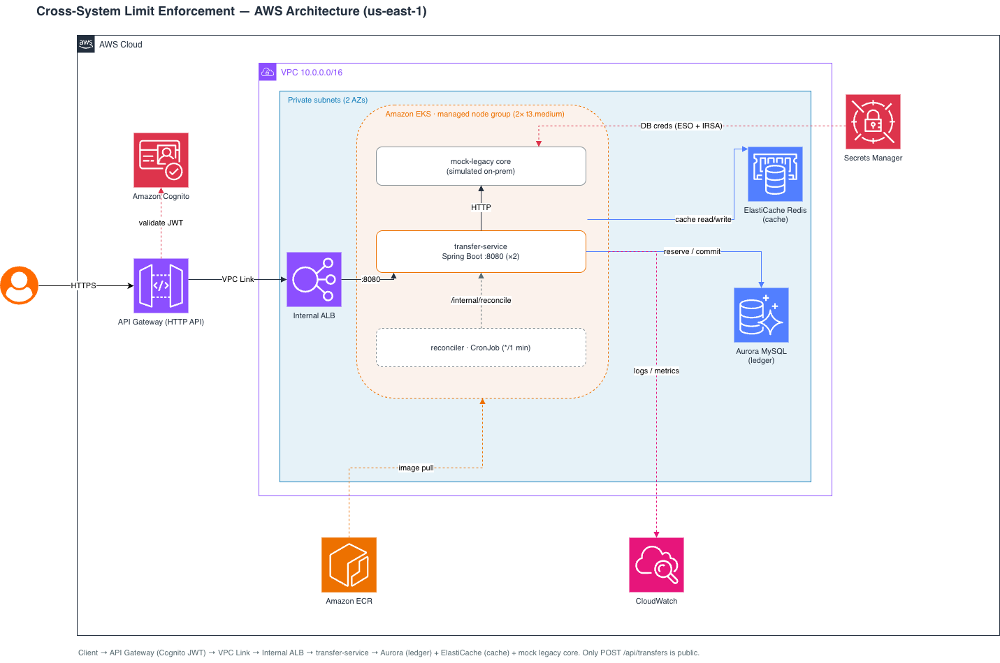

# Cross-System Limit Enforcement

A Java **Spring Boot** service that enforces a cumulative **daily transfer limit** across a
legacy core-banking system and a new cloud service during a **Strangler Fig** migration.
The invariant it protects: *a customer may transfer at most a fixed amount per day, summed
across all transfer types* — held correct even while two systems that don't share a database
both move money.

The running total is **derived, never stored**: it's a live `SUM` over a reservation ledger.
Each transfer walks a **reserve → commit / release** lifecycle, concurrent same-customer
transfers serialize on a **database gap lock**, and timeouts are settled by a **reconciler**
that queries the core rather than guessing. The legacy total is one additive term behind a
config flag, so the eventual cutover is a deletion, not a rewrite.

- **Input:** a transfer request (`transferId`, `customerId`, `amount`, `currency`)
- **Output:** an enforced outcome — `COMMITTED`, `PENDING_RECONCILIATION`, `LIMIT_EXCEEDED`, `REJECTED_BY_CORE`, or fail-closed on an unavailable limit read
- **Backbone (cloud):** Amazon EKS + Amazon API Gateway + Amazon Aurora MySQL + Amazon ElastiCache + AWS Secrets Manager, deployed with **AWS CDK**
- **On-prem (simulated):** a mock legacy core that serves the daily-total / execute / status contract

> **Disclaimer:** This project is sample/educational code and is not intended for production use
> without additional security hardening and review. The full design write-up lives in
> [`docs/aws-modernization-cross-system-limits.md`](docs/aws-modernization-cross-system-limits.md).

---

## Architecture

<!-- Add the architecture diagram here, e.g. docs/architecture.png -->


### Request flow (numbered in the diagram)

1. **Sign in** — the client authenticates against **Amazon Cognito** (User Pool) and receives a JWT.
2. **Request + token** — the client calls the **API Gateway** HTTP API over HTTPS with the token in the `Authorization` header. A JWT authorizer validates it on every route (invalid → `401`). Only `POST /api/transfers` is exposed.
3. **VPC Link → internal ALB → pod** — API Gateway forwards the request through a **VPC Link** to an **internal ALB**, which routes to a **Transfer Service** pod on **Amazon EKS**.
4. **Limit check (one short transaction)** — the service opens an **Aurora** transaction and runs `SELECT SUM(amount) … FOR UPDATE`, taking a gap lock on `(customer_id, txn_date)`. It composes the running total: `legacyTotal + cloudCommitted + cloudInFlight`, reading the legacy total through the mock core (cached briefly in **ElastiCache**).
5. **Reserve** — if `total + amount ≤ limit`, it inserts a `RESERVED` row (which counts immediately, closing the concurrency race) and commits; otherwise it rejects with `422 LIMIT_EXCEEDED`.
6. **Execute** — the service calls the **legacy core** (`POST /api/transfers`) to move the money.
7. **Commit / release** — success → row `COMMITTED` (`200`); definitive failure → `RELEASED` (`502`); timeout → the row stays `RESERVED` and the caller gets `202 PENDING_RECONCILIATION`.
8. **Reconcile (never guess)** — a Kubernetes **CronJob** hits `POST /internal/reconcile` each minute. The reconciler claims expired `RESERVED` rows with `FOR UPDATE SKIP LOCKED`, queries the core's status API, and flips each to `COMMITTED` (settled) or `EXPIRED` (not settled), alerting on stuck rows.
9. **Secrets** — the DB credentials live in **AWS Secrets Manager** and are synced into the cluster by the **External Secrets Operator** via **IRSA** (no static secrets in git or the CloudFormation template).

---

## How the components work

| Component | Service | Responsibility |
|---|---|---|
| **Transfer Service** | Spring Boot 3.3 / Java 21 on **Amazon EKS** | Orchestrates the reserve → commit/release flow and owns the limit logic. Listens on `:8080`. |
| **Amazon Cognito** | User Pool + App Client | Authentication; issues the JWT the gateway validates. |
| **API Gateway** | HTTP API + VPC Link | Public entry point. JWT authorizer on the route; internal endpoints are never routed. |
| **Internal ALB** | Application Load Balancer | Private target for the VPC Link; forwards to the Service via a `TargetGroupBinding`. |
| **Aurora MySQL** | Serverless v2 (MySQL-compatible) | The `transfer_reservation` ledger. Strong consistency + row-level `FOR UPDATE` locking. |
| **ElastiCache Redis** | Single-node cache | Short-TTL cache of the legacy daily total to keep it off the hot path. |
| **Reconciler** | Kubernetes `CronJob` | The "dumb trigger" that calls `/internal/reconcile`; all safety logic lives in the service. |
| **Legacy core (mock)** | Node service on EKS (`legacy` namespace) | Stands in for the on-prem mainframe: daily-total / execute / status APIs + a control surface. |
| **Circuit breaker** | Resilience4j | Wraps the legacy total read and **fails closed** (`503`) when the core is unavailable. |
| **Secrets Manager + ESO** | Secrets + External Secrets Operator | Generates DB creds and syncs them into a k8s Secret via IRSA. |
| **CloudWatch / Prometheus** | Observability | Actuator exposes `health`, `metrics`, and `prometheus`; EKS control-plane logs enabled. |

The default (Aurora) profile targets a MySQL-compatible database; a `local` profile runs everything
on an in-memory **H2** database with no external services, and a `stub-legacy` profile swaps in an
in-process stand-in for the legacy core.

---

## Prerequisites

**To run locally**
- **Java 21** and **Maven**
- (Optional) a local Redis; caching falls back to a no-op when absent

**To deploy to AWS (`infra/`, AWS CDK)**
- **Node.js 20+** (the CDK requires it; Node 18 only synthesizes)
- **Docker** running (container images are built locally during deploy)
- **AWS CLI v2** configured with credentials, and the account/region **bootstrapped** for CDK
- **kubectl** for post-deploy inspection
- An **Amazon Cognito** User Pool + app client to protect the API (an existing pool can be reused)

---

## Project structure

```
sample-cross-system-limit-enforcement/
├── src/main/java/com/meridian/limit/
│   ├── LimitEnforcementApplication.java
│   ├── transfer/                     # Online flow: controller, TransferService, ReservationService
│   ├── reservation/                  # Ledger entity, status enum, repo (FOR UPDATE + SKIP LOCKED)
│   ├── legacy/                       # Legacy core client, short-TTL cache, circuit breaker
│   │   └── stub/                     # In-process stub core (stub-legacy profile)
│   ├── reconcile/                    # Reconciler batch job + scheduler + internal trigger
│   └── config/                       # Typed properties, read-source flag
├── src/main/resources/
│   ├── application.yml               # Default (Aurora) profile
│   ├── application-local.yml         # In-memory H2, no external services
│   ├── application-stub-legacy.yml   # H2 + in-process legacy stub
│   └── db/migration{,-h2}/           # Flyway migrations
├── src/test/java/...                 # JUnit tests
│
├── Dockerfile                        # App image (multi-stage Maven build → Temurin 21 JRE, non-root)
├── mock-legacy/                      # Standalone mock "on-prem" legacy core
│   ├── server.js                     # Zero-dependency Node server (daily-total / execute / status + control)
│   └── Dockerfile
│
├── infra/                            # AWS CDK (TypeScript) — one stack, one `cdk deploy`
│   ├── bin/app.ts
│   ├── lib/limit-enforcement-stack.ts
│   ├── README.md                     # Detailed infra guide
│   ├── package.json · tsconfig.json · cdk.json
│
├── docs/
│   └── aws-modernization-cross-system-limits.md   # Full design write-up
├── pom.xml
└── README.md
```

---

## Run locally

Uses an in-memory H2 database (MySQL mode); no external services required.

```bash
mvn spring-boot:run -Dspring-boot.run.profiles=local
```

Make a transfer:

```bash
curl -sS -X POST http://localhost:8080/api/transfers \
  -H 'Content-Type: application/json' \
  -d '{"transferId":"t-1","customerId":"cust-1","amount":100.00,"currency":"USD"}'
```

### End-to-end demo with the in-process stub core

The `stub-legacy` profile swaps in an in-memory stand-in for the legacy core so you can drive the
whole flow over HTTP without a mainframe:

```bash
mvn spring-boot:run "-Dspring-boot.run.profiles=local,stub-legacy"
```

Arrange scenarios, then hit `/api/transfers`:

```bash
# seed a customer's legacy daily total
curl -X POST localhost:8080/stub/legacy/total \
  -H 'Content-Type: application/json' -d '{"customerId":"c1","total":"49999999.00"}'

# choose the next core execution outcome: SUCCESS | FAILURE | TIMEOUT
curl -X POST localhost:8080/stub/legacy/next-result \
  -H 'Content-Type: application/json' -d '{"result":"TIMEOUT"}'

# force the legacy total API down (drives fail-closed)
curl -X POST localhost:8080/stub/legacy/total-unavailable \
  -H 'Content-Type: application/json' -d '{"unavailable":"true"}'

# manually trigger reconciliation (what the CronJob does in the cluster)
curl -X POST localhost:8080/internal/reconcile
```

---

## Deploy to AWS

The cloud infrastructure is defined in [`infra/`](infra) as an AWS CDK app: **EKS** running the
Transfer Service and the mock legacy core, fronted by **API Gateway** (VPC Link → internal ALB),
backed by **Aurora MySQL** and **ElastiCache**, with DB creds delivered via **Secrets Manager +
External Secrets Operator**. Both container images are built and pushed to ECR during `cdk deploy`.

### Step 1 — Configure AWS credentials

Point the AWS CLI (and therefore CDK) at your account and region.

```bash
# Recommended: temporary credentials via IAM Identity Center (AWS SSO)
aws configure sso --profile my-profile
export AWS_PROFILE=my-profile

# Verify the identity CDK will deploy as
aws sts get-caller-identity
```

> If IAM Identity Center is unavailable to you, `aws configure` accepts a static
> access key as a fallback. Prefer short-lived credentials where possible, and
> never commit `~/.aws/credentials`.

CDK uses the same default credential chain as the CLI (`AWS_PROFILE`, environment variables, or the
`aws configure` defaults), so once `aws sts get-caller-identity` returns your account, you're set.

### Step 2 — Bootstrap (one-time per account/region)

```bash
cd infra
npm install
npx cdk bootstrap aws://<ACCOUNT_ID>/us-east-1
```

### Step 3 — Deploy

```bash
# Reuses an existing Cognito pool by default. Override via context if needed:
#   -c cognitoUserPoolId=... -c cognitoClientId=... -c cognitoRegion=...
npx cdk deploy
```

Deploy takes ~20–25 min (mostly the EKS control plane and node group). Note the stack **Outputs**:
`TransfersUrl`, `ApiEndpoint`, `ClusterName`, `AuroraEndpoint`, `RedisEndpoint`, `DbSecretName`, and
a ready-to-run `KubeconfigCommand`.

### Step 4 — Point kubectl at the cluster

```bash
aws eks update-kubeconfig --name <ClusterName> --region us-east-1

kubectl get pods -n app
kubectl get pods -n legacy
kubectl get externalsecret,secret -n app     # db-credentials should be present
kubectl get targetgroupbindings -n app
```

### Step 5 — Create a user (if not reusing an existing account)

```bash
POOL_ID=<UserPoolId>

aws cognito-idp admin-create-user \
  --user-pool-id "$POOL_ID" \
  --username you@example.com \
  --user-attributes Name=email,Value=you@example.com Name=email_verified,Value=true \
  --message-action SUPPRESS --region us-east-1

aws cognito-idp admin-set-user-password \
  --user-pool-id "$POOL_ID" \
  --username you@example.com --password '<StrongPassword>' \
  --permanent --region us-east-1
```

### Step 6 — Bind the user to a customer

The service only lets an authenticated user transact for the customer they are bound to.
Until a binding exists, every transfer returns `403 Forbidden`. Look up the user's Cognito
`sub`, then redeploy with the binding:

```bash
SUB=$(aws cognito-idp admin-get-user --user-pool-id "$POOL_ID" \
  --username you@example.com --region us-east-1 \
  --query "UserAttributes[?Name=='sub'].Value" --output text)

cd infra
npx cdk deploy -c principalCustomerMap="${SUB}=c1"
```

Bind several users with comma-separated pairs: `-c principalCustomerMap="<sub1>=c1,<sub2>=c2"`.
Requests must then use the bound `customerId` (here `c1`). The binding is config-seeded for the
demo; a real system would look it up from a customer datastore.

---

## API

| Method | Path | Exposure | Purpose |
|---|---|---|---|
| POST | `/api/transfers` | **Public** (JWT-protected via API Gateway) | Submit a transfer; enforces the daily limit |
| POST | `/internal/reconcile` | In-cluster only (never routed by the gateway) | Trigger a reconciliation sweep |
| POST | `/stub/legacy/*` | `stub-legacy` profile only | Arrange demo scenarios on the in-process stub |
| GET | `/actuator/health` · `/metrics` · `/prometheus` | In-cluster | Probes and observability |

Call the deployed API with a Cognito bearer token:

```bash
TOKEN=<cognito id/access token>
API=$(aws cloudformation describe-stacks --stack-name LimitEnforcementStack \
  --query "Stacks[0].Outputs[?OutputKey=='TransfersUrl'].OutputValue" --output text)

curl -sS -X POST "$API" \
  -H "Authorization: Bearer $TOKEN" \
  -H 'Content-Type: application/json' \
  -d '{"transferId":"t-1","customerId":"c1","amount":100.00,"currency":"USD"}'
```

### Outcome → HTTP status

| Outcome | HTTP | Meaning |
|---|---|---|
| `COMMITTED` | `200` | Within the limit and the core confirmed settlement |
| `PENDING_RECONCILIATION` | `202` | Core call timed out; reservation held until the reconciler decides |
| `LIMIT_EXCEEDED` | `422` | The composed daily total would breach the limit |
| `REJECTED_BY_CORE` | `502` | The core rejected the transfer; capacity released |
| *(limit read unavailable)* | `503` | Legacy total read failed; **fail-closed** rather than risk a breach |

---

## The invariant and the reservation lifecycle

The whole design exists to keep one rule true across two systems that don't share a database:

> A customer may transfer at most a fixed amount per day, summed across **all** transfer types.

Every transfer is a row in `transfer_reservation` that walks a small state machine:

| Status | Counts toward total? | When |
|---|---|---|
| `RESERVED` | **Yes** | Passed the limit check and inserted — *before* the core call, which closes the concurrency race |
| `COMMITTED` | **Yes** | The core confirmed the money moved |
| `RELEASED` | No | The core rejected it; no money moved |
| `EXPIRED` | No | Timed out and reconciliation could not confirm settlement (raises an alert) |

The cloud portion of the total is a live query over `RESERVED` + `COMMITTED` rows — a derived value that
**cannot drift** from the rows it's derived from. Concurrent same-customer transfers serialize on the
`SELECT … FOR UPDATE` gap lock; different customers never contend. The reconciler only releases capacity
when it has a **definitive** answer about whether money moved.

The migration cutover is a config change, not a rewrite: flip `limit-enforcement.read-source` from
`COMPOSED` to `CLOUD` (Phase 3) to stop consulting the legacy leg, then delete the legacy adapter (Phase 4).

---

## Testing

### Unit tests

```bash
mvn test
```

Covers within-limit commit, composed-total rejection, in-flight reservations counting toward the limit,
core rejection/timeout handling, idempotency, and fail-closed behavior.

### Exercise the deployed system

The mock legacy core has a control surface, reachable in-cluster (it is intentionally not public):

```bash
kubectl -n legacy port-forward svc/mock-legacy 8081:8080 &

# seed a customer's legacy daily total (near the limit)
curl -X POST localhost:8081/control/total \
  -H 'Content-Type: application/json' -d '{"customerId":"c1","total":49999900.00}'

# choose the next core outcome: SUCCESS | FAILURE | TIMEOUT
curl -X POST localhost:8081/control/next-result \
  -H 'Content-Type: application/json' -d '{"result":"TIMEOUT"}'

# force the legacy total API down (drives fail-closed / 503)
curl -X POST localhost:8081/control/total-unavailable \
  -H 'Content-Type: application/json' -d '{"unavailable":"true"}'

curl -X POST localhost:8081/control/reset
```

Then POST transfers through the gateway and watch the outcomes. The reconciler `CronJob` runs every
minute and drives any timed-out `RESERVED` rows to a definitive state.

### Type-check / synth the infra

```bash
cd infra
npx tsc --noEmit
npx cdk synth
```

---

## Configuration

### Application (`limit-enforcement.*`)

| Property | Env override | Default | Purpose |
|---|---|---|---|
| `default-daily-limit` | — | `50000000.00` | Per-customer daily limit |
| `currency` | — | `USD` | Currency the limit is expressed in |
| `reservation-ttl` | — | `60s` | How long a `RESERVED` row holds capacity before the reconciler investigates |
| `reservation-max-age` | — | `1h` | Hard safety valve to force-expire a stuck reservation |
| `read-source` | `LIMIT_ENFORCEMENT_READ_SOURCE` | `COMPOSED` | `COMPOSED` (legacy + cloud) or `CLOUD` (Phase 3+) |
| `reconciler.enabled` | `LIMIT_ENFORCEMENT_RECONCILER_ENABLED` | `true` | In-process scheduler; set `false` on EKS (CronJob drives it) |
| `principal-customer-mappings` | `PRINCIPAL_CUSTOMER_MAP` | *(empty)* | Comma-separated `sub=customerId` bindings. Empty rejects every transfer with `403`. Set via CDK context `principalCustomerMap` |

### Runtime environment variables (set by the Deployment)

| Variable | Purpose |
|---|---|
| `DB_URL` / `DB_USERNAME` / `DB_PASSWORD` | Aurora connection (username/password from the synced `db-credentials` secret) |
| `REDIS_HOST` / `REDIS_PORT` | ElastiCache endpoint |
| `LEGACY_DAILY_TOTAL_URL` / `LEGACY_EXECUTE_URL` / `LEGACY_STATUS_URL` | Legacy core endpoints |

### Cognito

The stack provisions its **own** Cognito user pool and app client — nothing is reused. After
deploy, read `UserPoolId` and `UserPoolClientId` from the stack outputs; the API Gateway JWT
authorizer is wired to them automatically.

---

## Troubleshooting

- **`401` from the API** — missing/invalid Cognito token, or the token's audience doesn't match the configured app client. Confirm `cognitoClientId`.
- **All transfers return `503`** — the legacy total read is failing (circuit open / mock unavailable). Check the `mock-legacy` pod and whether `total-unavailable` was left on.
- **`cdk deploy` fails immediately** — you're on Node 18. The CDK requires **Node 20+** to deploy; Docker must also be running.
- **Pods `ImagePullBackOff` / arch mismatch** — the images are built `linux/amd64`; ensure your nodes match (they do by default) and Docker built successfully.
- **`targetgroupbindings` not healthy** — the AWS Load Balancer Controller needs a moment after deploy; check `kubectl get pods -n kube-system` for the controller and the target group health in the console.
- **`db-credentials` secret missing** — the External Secrets Operator hasn't synced yet; check `kubectl describe externalsecret -n app db-credentials` and the ESO pods in the `external-secrets` namespace.
- **A transfer is stuck `PENDING_RECONCILIATION`** — expected until the reconciler confirms with the core; it settles within a minute, or force it with `kubectl create job --from=cronjob/reconciler -n app reconcile-now`.

---

## Cleanup

```bash
cd infra
npx cdk destroy
```

By default the stack is safe to keep: Aurora and the Cognito user pool use `RemovalPolicy.RETAIN`, and
Aurora has deletion protection and 7-day backups, so `cdk destroy` leaves them in place. For a full
teardown of a demo deployment, switch to the destructive settings first, then destroy:

```bash
npx cdk deploy -c demoTeardown=true
npx cdk destroy -c demoTeardown=true
```

Container image assets created by the CDK bootstrap remain in the bootstrap ECR repository; remove them
separately for a full teardown.

---

## Security

Already in place:
- The API is Cognito-JWT protected at the edge; `/internal/*` and `/stub/*` are never routed.
- Data stores sit in private subnets, reachable only from the cluster security group.
- DB credentials are generated, stored in Secrets Manager, and delivered via IRSA + External Secrets — no static secrets in git or the CloudFormation template.
- Aurora storage encryption is enabled; the limit read fails closed on error.

Harden before anything real: add **AWS WAF** and throttling on the API, terminate TLS at the ALB with
**ACM**, add **NetworkPolicies** and tighter egress, move the "legacy" system behind a real Direct
Connect/VPN boundary (a separate account), and back the principal-to-customer binding with a customer datastore.

See [SECURITY.md](SECURITY.md) for the full posture — authentication/authorization, networking, encryption,
IAM least-privilege, secret management, failure handling, monitoring, and the accepted-risk justifications. To
report a vulnerability, follow [CONTRIBUTING.md](CONTRIBUTING.md#security-issue-notifications) — please do not
open a public issue.

## Contributing

Contributions are welcome. Please read [CONTRIBUTING.md](CONTRIBUTING.md) and our
[Code of Conduct](CODE_OF_CONDUCT.md).

## Authors

- Rohit Saha
- Ganesh Gaikwad

## License

This project is licensed under the MIT-0 License. See the [LICENSE](LICENSE) file.
