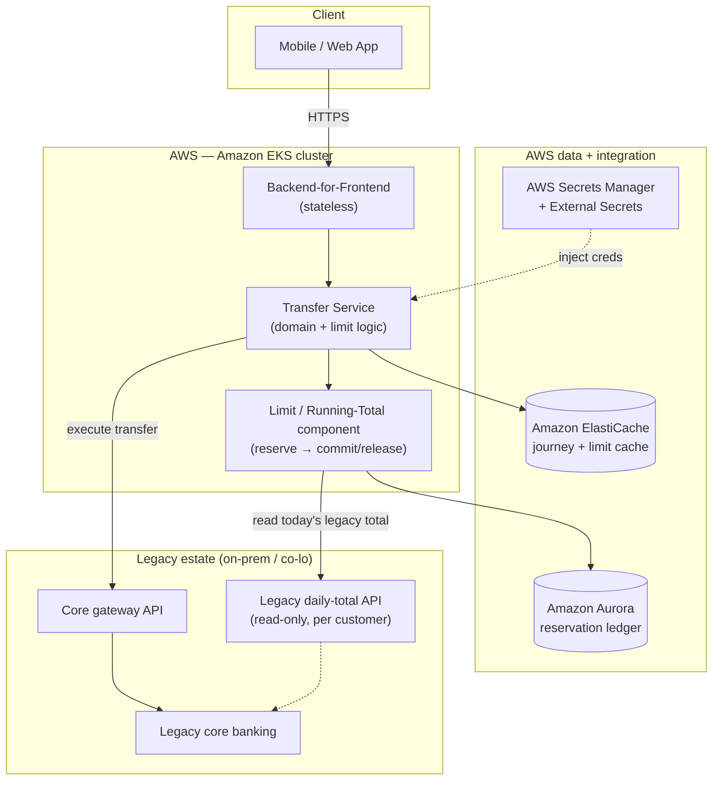
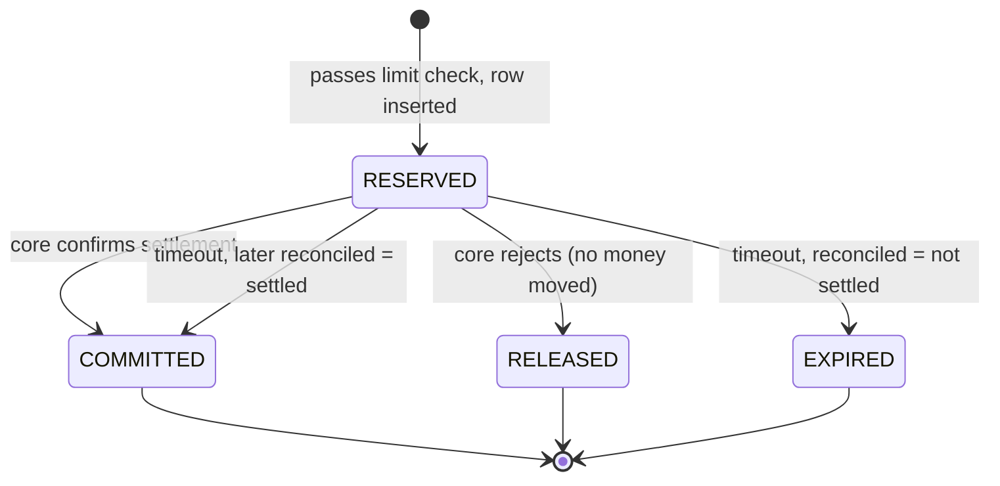
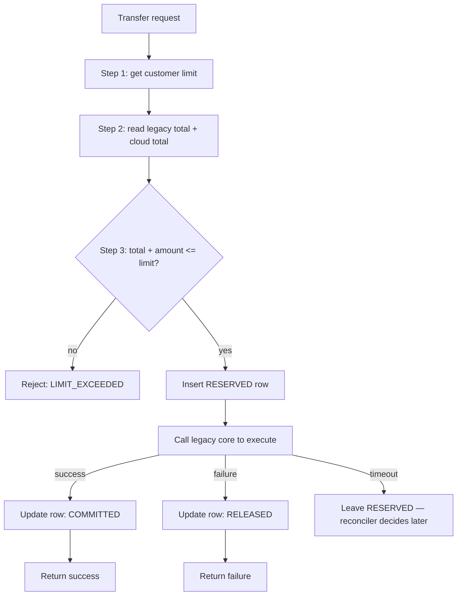
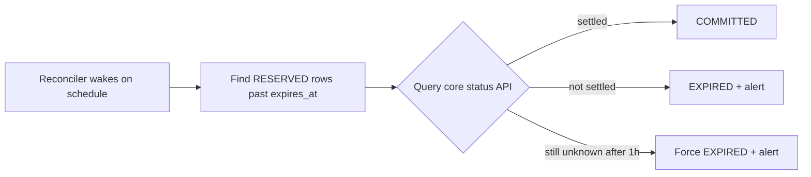

# Enforcing a Daily Transfer Limit Across a Mainframe and the Cloud — Without Double-Spend

*How to modernize a core-banking workflow on AWS with the Strangler Fig pattern, while keeping a hard money-movement invariant correct through every phase of the migration.*

---

## TL;DR

When you move a banking workflow off a legacy core system one slice at a time, you hit a period where a single business rule — "a customer may transfer at most *X* per day" — must hold true across **two systems that don't share a database**: the legacy core still processing some transfers, and your new cloud service processing the rest. Get this wrong and a customer can exceed their regulatory limit, or worse, you double-charge them.

This post walks through a generic, reusable design for enforcing a cumulative daily limit across a legacy core and a new AWS-hosted microservice. The core ideas:

- Treat the running total as a **derived value**, never a stored counter.
- Use a **reserve → commit / release** lifecycle around each money movement.
- Serialize concurrent transfers for the same customer with a **database gap lock**, not a distributed lock.
- Count **in-flight reservations** so two concurrent transfers can't both slip past the limit.
- Reconcile timeouts against the core system's status API — **never guess about money**.
- Make the eventual "legacy is gone" cutover a **config toggle and a code deletion**, not a rewrite.

Everything below is deployed on Amazon EKS, Amazon Aurora, Amazon ElastiCache, and AWS Secrets Manager, and the pattern generalizes to any quota, velocity, or inventory check you need to enforce across a system boundary during a migration.

---

## The setting: a Strangler Fig migration in mid-flight

Imagine a fictional retail bank, **Meridian Bank**. Its "move money between accounts" feature has run for decades on a legacy core-banking mainframe. Meridian is modernizing onto AWS using the [Strangler Fig pattern](https://martinfowler.com/bliki/StranglerFigApplication.html): new functionality is built as cloud-native microservices that sit in front of the legacy core, and traffic is migrated slice by slice until the old system can be retired.

During Phase 1, only *same-owner* transfers (a customer moving money between their own accounts) are handled by the new **Transfer Service** on AWS. Every other transfer type still flows through the legacy core. Both systems move real money. Neither can be switched off.

Now the regulator's rule lands on both of them at once:

> A customer may transfer at most **50,000,000** currency units per day, summed across **all** transfer types.

The legacy core knows about the transfers *it* processed today. The cloud Transfer Service knows about the transfers *it* processed today. Neither knows the whole picture. Before the cloud service executes a transfer, it has to answer a deceptively hard question:

> *Given everything this customer has already moved today — on the mainframe and in the cloud — will this transfer push them over the daily limit?*

This is the problem every "modernize off the core" program eventually runs into. Let's design it properly.

---

## Target architecture on AWS



Mapping to AWS building blocks:

| Concern | AWS service | Why |
|---|---|---|
| Compute for microservices | **Amazon EKS** | Standard container orchestration; batch jobs run as native `CronJob`s in the same cluster |
| Transactional reservation ledger | **Amazon Aurora (MySQL-compatible)** | Strong consistency, row-level locking (`SELECT … FOR UPDATE`), Multi-AZ durability |
| Low-latency cache | **Amazon ElastiCache (Redis / Valkey)** | Journey state and short-TTL caching of the legacy total on the hot path |
| Secrets & rotation | **AWS Secrets Manager** + External Secrets Operator | One secret, rotated once, consumed by app pods and cron pods alike |
| Elastic scale | **Karpenter / KEDA on EKS** | Scale the transfer tier on CPU or custom metrics during peak windows |
| Connectivity to legacy | **AWS Direct Connect / Site-to-Site VPN** | Private path to the core gateway and the legacy daily-total API |
| Observability | **Amazon CloudWatch / Container Insights + Amazon Managed Prometheus** | Metrics, logs, and alerting on reconciliation and cron freshness |

The legacy estate exposes two things to the cloud: a **gateway API** to execute transfers, and a **read-only daily-total API** that returns "how much has this customer moved through the core today." That read-only API is the seam we build against.

---

## The naive approach, and why it breaks

The obvious first attempt:

```text
total = legacyDailyTotal(customer) + cloudDailyTotal(customer)
if total + amount <= limit:
    executeTransfer()
```

This is wrong in two ways that matter enormously when the payload is money.

**1. Where does `cloudDailyTotal` come from?** If you keep a per-customer counter column and increment it on each transfer, that counter will eventually drift from reality — a crash between "execute" and "increment," a bug in a rollback path, a manual data fix, and now your counter and your actual transfers disagree. For money, drift is unacceptable.

**2. The concurrency race.** Two transfers for the same customer arrive at the same instant on two different pods. Both read the same total, both see headroom, both pass the check, both execute. The customer ends the day over the limit. A naive check has a time-of-check-to-time-of-use race that a mainframe's single-threaded batch never had to worry about — but your horizontally-scaled cloud service does.

Let's fix both.

---

## Idea 1: the running total is *derived*, never stored

We keep exactly one kind of state: a row per transfer attempt in a `transfer_reservation` table in Aurora. There is **no** counter column, **no** daily-total row, **no** midnight reset job.

```sql
CREATE TABLE transfer_reservation (
    reservation_id   CHAR(36)      NOT NULL,
    customer_id      VARCHAR(32)   NOT NULL,
    txn_date         DATE          NOT NULL,
    amount           DECIMAL(19,2) NOT NULL,
    currency         VARCHAR(8)    NOT NULL,
    status           VARCHAR(12)   NOT NULL,   -- RESERVED | COMMITTED | RELEASED | EXPIRED
    created_at       DATETIME(6)   NOT NULL,
    expires_at       DATETIME(6)   NOT NULL,
    committed_at     DATETIME(6)   NULL,
    PRIMARY KEY (reservation_id),
    KEY idx_running_total (customer_id, txn_date, status)
);
```

The cloud portion of the daily total is a live query, always on the same index:

```sql
SELECT COALESCE(SUM(amount), 0)
FROM transfer_reservation
WHERE customer_id = :customer
  AND txn_date    = :today
  AND currency    = :currency
  AND status IN ('RESERVED', 'COMMITTED');
```

`RELEASED` (the core rejected it) and `EXPIRED` (we timed out and couldn't confirm) drop out of the sum automatically. A derived value **cannot** drift from the rows it's derived from. If you ever need to audit "why was this customer's total 45M at 14:03," you just look at the rows.

---

## Idea 2: reserve → commit / release

Every transfer walks a small state machine, and the reservation row is what tracks it.



- **RESERVED** — we've decided the transfer is within the limit and inserted a row. It counts toward the total *immediately*, before we've even called the core.
- **COMMITTED** — the core confirmed the money moved. Still counts.
- **RELEASED** — the core rejected it; no money moved. Stops counting.
- **EXPIRED** — the core call timed out and reconciliation couldn't confirm settlement. Stops counting, and raises an operator alert.

The critical insight: **a `RESERVED` row counts toward the limit while the core call is in flight.** That's what closes the concurrency race.

Here's the online flow:



And the composed total that Step 3 evaluates:

```text
runningTotal = legacyTotal          # from the read-only legacy API
             + cloudCommitted        # SUM of COMMITTED rows
             + cloudInFlight         # SUM of RESERVED rows
```

The legacy total is treated as an **opaque scalar** — we call the read-only API, cache it in ElastiCache for a few seconds to keep it off the hot path, and trust it. We never reach into the legacy database or reason about its internals. That respect for the boundary is what makes the two systems safely composable.

---

## Idea 3: serialize with a database gap lock, not a distributed lock

Now the race. We wrap Step 3 in a single Aurora transaction, and the **first** statement takes the running-total sum *with a lock*:

```sql
BEGIN;

-- reads the cloud total AND locks the (customer_id, txn_date) range
SELECT COALESCE(SUM(amount), 0)
FROM transfer_reservation
WHERE customer_id = :customer
  AND txn_date    = :today
  AND currency    = :currency
  AND status IN ('RESERVED', 'COMMITTED')
FOR UPDATE;

-- application checks: legacyTotal + cloudTotal + amount <= limit ?
-- if OK:
INSERT INTO transfer_reservation
  (reservation_id, customer_id, txn_date, amount, currency, status, created_at, expires_at)
VALUES
  (:id, :customer, :today, :amount, :currency, 'RESERVED', NOW(6), NOW(6) + INTERVAL 60 SECOND);

COMMIT;
```

The `FOR UPDATE` acquires a gap lock on the `(customer_id, txn_date)` range. Two concurrent transfers for the *same customer* now serialize at the database:

```text
Pod A: BEGIN; SELECT SUM ... FOR UPDATE   -> 25M   (lock acquired)
Pod A: check 25M + 20M <= 50M  OK
Pod A: INSERT RESERVED 20M
Pod A: COMMIT                              (lock released)

Pod B: BEGIN; SELECT SUM ... FOR UPDATE   -> BLOCKS on Pod A's lock
                                           ... A commits ...
Pod B:                                     -> 45M   (now sees A's row!)
Pod B: check 45M + 20M = 65M > 50M  FAIL
Pod B: ROLLBACK -> reject LIMIT_EXCEEDED
```

No ZooKeeper, no Redis lock, no distributed-lock library, no new infrastructure to operate. The transactional database you already need for the ledger *is* your concurrency primitive. Transfers for **different** customers touch different ranges and never contend, so this doesn't serialize your whole throughput — only same-customer transfers, which is exactly the scope of the invariant.

> **AWS note:** Aurora gives you Multi-AZ durability and fast failover under this pattern, so the lock and the ledger survive an instance failure without losing the invariant. Keep these transactions short — lock, check, insert, commit — so the range is held for milliseconds.

---

## Idea 4: never guess about money — reconcile timeouts

What if the core call neither clearly succeeds nor clearly fails — it just times out? The money may or may not have moved. This is the scariest case, and the reservation model handles it cleanly.

Each `RESERVED` row has an `expires_at` (say, 60 seconds out). The TTL is **not** a death sentence for the reservation — it's the trigger for a **reconciler** to investigate:

- A slow-but-healthy core call keeps holding its reserved capacity until it returns. Correct — the money might move.
- When the TTL passes with no definitive outcome, a reconciliation job queries the core's **status API** for that transaction:
  - Core says *settled* → flip the row to `COMMITTED` (it correctly still counted).
  - Core says *not found / failed* → flip to `EXPIRED` (release the capacity).
- A hard safety valve (e.g. force-expire after 1 hour) ensures a stuck reservation can never lock a customer out of transfers forever.

The rule the reconciler lives by: **capacity is released only when we have a definitive answer about whether money moved.** It never assumes.



There's a related discipline worth stating explicitly, because it recurs everywhere in banking modernization: **never auto-recover a record where money might have moved.** A row still mid-core-call is left for an operator runbook, not silently retried by a background job. Automatic retries are safe only for states where you *know* nothing has been posted.

---

### Running the reconciler and other batch work on AWS

Two clean options for triggering the reconciler (and any nightly sweep):

**Option A — Kubernetes `CronJob` in the same EKS cluster.** The control plane triggers a short-lived pod that calls an internal endpoint. Zero new infrastructure, native timezone support, `concurrencyPolicy: Forbid` to prevent overlap, and a one-command kill switch (`kubectl patch cronjob … suspend=true`). Because the *service* holds all the safety logic (idempotency, `SELECT … FOR UPDATE SKIP LOCKED` claiming), the trigger can be dumb and retries are always safe.

**Option B — Amazon EventBridge Scheduler → Lambda / API destination.** Fully outside the cluster, first-class timezone support, DLQ on failure. Better if governance forbids in-cluster schedulers or you need to fan out to other AWS services (Step Functions, Glue).

For work that lives *inside* one EKS cluster and calls a service in that same cluster, Option A is usually the lower-friction choice; reach for EventBridge when you need an AWS-native trigger that spans services or clusters. Either way, keep the trigger contract identical so you can switch later without touching the service.

If you shard the batch across pods, claim work with:

```sql
SELECT ... FROM transfer_reservation
WHERE status = 'RESERVED' AND expires_at < NOW(6)
ORDER BY expires_at
LIMIT :batchSize
FOR UPDATE SKIP LOCKED;
```

`SKIP LOCKED` lets N pods claim disjoint row sets with zero application-level coordination — the same database primitive doing the heavy lifting again.

---

## Idea 5: make the cutover a config toggle, not a rewrite

Here's the part that pays off the whole "modernization" framing. Eventually the migration completes: every transfer type moves to the cloud, and the legacy core is retired. What happens to all this cross-system logic?

Because the legacy total was always just *one additive term* consulted through a single adapter, and the read source is behind configuration, the end state is a **deletion**, not a rewrite:

```text
# Phase 1  (legacy authoritative for its slice, cloud for its slice)
runningTotal = legacyTotal + cloudCommitted + cloudInFlight
readSource   = composed

# Phase 2  (dual-write proven, monitored; still composing)
runningTotal = legacyTotal + cloudCommitted + cloudInFlight
readSource   = composed        # + dashboards comparing the two legs

# Phase 3  (cloud is now authoritative)
runningTotal =              cloudCommitted + cloudInFlight
readSource   = cloud         # legacy adapter no longer called

# Phase 4  (legacy retired)
# delete the legacy adapter and its config. Nothing else changes.
```

Design principles that make this safe:

- **Gate the flip behind a config flag** (served from your config store — e.g. AWS AppConfig or a settings table), so moving the source of truth is a controlled runtime change, not a risky deploy.
- **Move read authority and write behavior independently.** If the legacy system later offers a *write* API so it can become the single accumulator, dual-write to it behind an **idempotency key** (use your `transferId`) so retries and reconciler re-runs never double-count. Prove the two totals agree in a dual-write phase *before* flipping which one is authoritative.
- **Watch the double-count trap.** The instant you start writing every cloud transfer into the legacy accumulator, "legacy + cloud" becomes a double-count. The switch from *sum* to *single source* must land in the **same** change as the write hook, coordinated by the same flag.
- **Watch the concurrency trap.** If you stop writing the cloud ledger, you also remove the gap lock that was serializing same-customer transfers. Don't drop it unless the new authoritative system provides an equivalent atomicity guarantee.

This is the difference between a migration that *ends* and one that leaves a permanent "temporary" integration behind. Build the seam so it can be removed.

---

## Fail-closed, fail-open — decide deliberately

Money systems need an explicit failure posture for every dependency, not a default:

- **Limit read fails** (legacy total API down, circuit open) → **fail closed**. Reject the transfer rather than risk breaching the limit. Wrap the call in a circuit breaker (e.g. Resilience4j) and treat the fallback as a hard error surfaced as `503`.
- **Enrichment / display data fails** (a friendly name, an icon) → **fail open**. Never block a valid money movement for a cosmetic lookup.
- **Reconciler genuinely can't determine an outcome after the safety window** → release the reservation *and alert*, so a stuck record can't lock a customer out — but a human confirms the money question.

Write these decisions down next to each integration. "What do we do when this dependency is down?" should never be answered by accident.

---

## What makes this reusable

Strip away "banking" and the pattern is a general answer to: *how do I enforce a global invariant across two systems that don't share a database, in real time, without corrupting the ledger, while I migrate from one to the other?*

The same shape applies to:

- **Spending / velocity limits** in any payments or wallet product.
- **Inventory or seat reservations** split across a legacy ERP and a new commerce service.
- **API quota or rate ceilings** enforced across an old gateway and a new one.
- **Credit / exposure limits** during a lending-platform migration.

The reusable primitives — derived totals over stored counters, reserve/commit/release, database gap locks for same-key serialization, `SKIP LOCKED` for batch fan-out, reconcile-don't-guess, and config-gated source-of-truth flips — are all boring, well-understood building blocks. That's the point. For money, boring-on-purpose is a feature.

---

## Reference checklist

If you're building this on AWS, here's the shortlist:

- [ ] Reservation ledger on **Amazon Aurora**, indexed on `(customer_id, txn_date, status)`.
- [ ] Running total computed as a live `SUM` — no counter columns.
- [ ] Step 3 in one short transaction with `SELECT … FOR UPDATE` to serialize same-customer transfers.
- [ ] `RESERVED` rows count toward the total to close the concurrency race.
- [ ] Legacy total read through a single adapter, cached briefly in **Amazon ElastiCache**, **fail-closed** on error via a circuit breaker.
- [ ] Reconciler on an **EKS CronJob** (or **EventBridge Scheduler**), claiming rows with `FOR UPDATE SKIP LOCKED`, that queries the core status API and never guesses.
- [ ] Source-of-truth behind a config flag (**AWS AppConfig** or equivalent); dual-write with an idempotency key before flipping authority.
- [ ] Secrets in **AWS Secrets Manager**, one rotation for app and cron pods.
- [ ] Metrics + alerts in **CloudWatch / Amazon Managed Prometheus** on reservation age, `EXPIRED` counts, and cron freshness.

Build the invariant to be correct today, across two systems — and build the seam so that tomorrow, when the legacy core is gone, the cross-system code is a clean deletion.

---

*This post describes a generalized, vendor-neutral design pattern. Code snippets are illustrative and written for clarity, not lifted from any production system. Adapt limits, TTLs, and failure policies to your own regulatory and operational requirements.*

*Compliance note: deployments that handle real financial transaction data may fall under regimes such as PCI-DSS, SOX, or regional financial regulation. This pattern does not claim to meet any such framework. Assess which obligations apply to your deployment and implement the controls they require. See the [AWS Shared Responsibility Model](https://aws.amazon.com/compliance/shared-responsibility-model/) and [AWS Compliance resources](https://aws.amazon.com/compliance/).*
